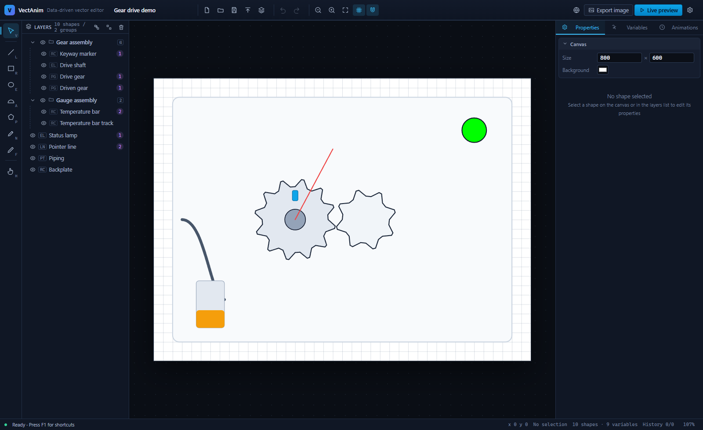
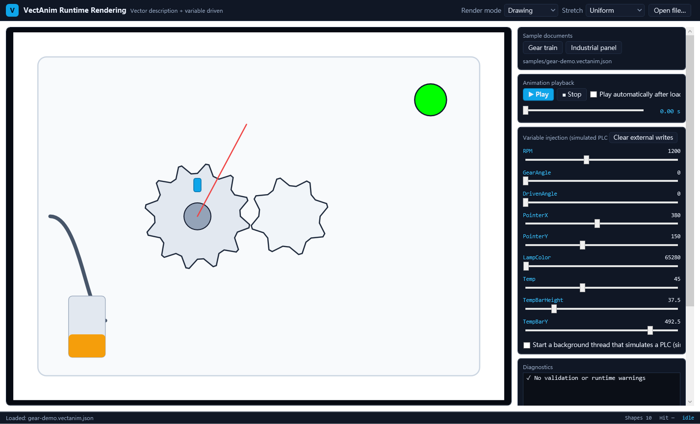

# VectAnim — 矢量图形数据驱动编辑器 + WPF 运行时渲染控件

> English: [README.en.md](README.en.md) | 中文

用**声明式矢量描述**替代位图/视频/GIF：在 Web 编辑器里画图、绑定变量、配置动画，导出 `.vectanim.json`；
WPF 端加载该文件，由 PLC / 传感器 / 业务变量实时驱动，**全程矢量渲染、无损缩放、可交互**。

适用场景：工业组态画面、机构运动示意、仪表盘、设备状态可视化、流程示意图。



---

## 快速开始

```bash
npm install            # 依赖全部装在项目内（含 npm 缓存）
npm run dev            # 编辑器开发模式 → http://localhost:5173

npm run build          # 构建编辑器 → dist/editor/
npm run dotnet:build   # 构建 WPF 类库 / Demo / 测试 / 探针
npm run dotnet:test    # 62 项逻辑测试
npm run dotnet:probe   # 离屏渲染 + 像素断言 + 性能探针
npm run dotnet:pack    # 打包 NuGet → artifacts/nuget/

npm run all            # 上面全部串起来（CI 用）
```

运行演示程序：

```bash
dotnet run --project dotnet/VectAnim.Demo/VectAnim.Demo.csproj
```



---

## 三个模块

| 模块 | 技术 | 说明 |
| --- | --- | --- |
| Web 编辑器 | TypeScript + Fabric.js v7 + Vite | 绘图、变量绑定、表达式/关键帧动画、实时预览、导入 SVG、导出 JSON |
| 数据契约 | `.vectanim.json` (v1.0) | 两端唯一接口，见 [Schema 规范](docs/02-Schema规范.md) |
| WPF 运行时 | C# / WPF（零第三方依赖） | `VectAnimViewer` 控件：解析、变量、表达式、关键帧、`DrawingContext` 矢量渲染、命中交互 |

## 界面语言

编辑器界面**默认英文**：顶栏的语言按钮可切到简体中文，选择记在 `localStorage`，也可以用 `?lang=zh` 直接指定。
WPF 控件内置同一套思路的字符串表，默认英文，可用环境变量 `VECTANIM_LANG=zh-CN` 或运行时 `Strings.Culture` 切换。

## 核心能力

**编辑器**

- 绘图：直线、矩形（圆角）、椭圆、半圆弧、多边形、钢笔（平滑曲线）、自由绘制
- 编辑：框选 / `Shift`·`Ctrl` 点击多选、拖动缩放旋转、方向键微移（`Shift` 加速）、分组（组合后整组操作）、层级、对齐/等距/翻转、撤销重做（历史合并）
- 吸附：网格吸附 + 对象边/中线吸附，缩放后容差仍为 6 屏幕像素
- **逐属性绑定**：任何数值/颜色属性都能一键切换「常量 ↔ 变量」，绑定后自动锁定对应交互
- **多选批量设置**：选中多个图形时列出它们的公共属性，可一次改值或一次绑定同一个变量
- **分组即单个对象**：组合也有自己的偏移/旋转/缩放/不透明度，可整体绑定变量、被表达式与关键帧驱动
- 变量表：增删改、重命名自动改写全部引用、实时值滑杆
- 动画：表达式（`t` + 白名单函数，实时语法校验）+ 关键帧时间轴（拖拽、缓动、循环、循环延时）
- 实时预览：与 WPF 端同语义的运行时，含告警面板
- 导入 SVG（矩形/圆/椭圆/多边形/折线/路径 → 原生图元）、导出 JSON / PNG / SVG
- 自动保存（localStorage）、拖放文件导入、完整快捷键

**WPF 控件**

- `FrameworkElement + OnRender`：不为每个图形创建 Shape，200 个动态图形约 **7.5 ms/帧**
- 几何/画刷/画笔/矩阵全缓存，脏检查用逐值比较（避免哈希碰撞导致的偶发画错）
- 变量外部写入优先，支持任意线程 `SetVariable`（内部切回 UI 线程）与批量写入
- 表达式依赖拓扑排序 + 循环检测；关键帧线性/缓动/循环/延时
- 几何级命中测试（考虑旋转变换），`ShapeClick` / 悬停事件返回图形 Id 与画布坐标
- 两种渲染模式（Drawing / Shapes）、`Stretch` 适配、`Zoom/Offset`、`RenderToBitmap` 离屏截图
- 加载容错：坏图形跳过、坏表达式跳过、变量缺失按 0，并逐条上报校验问题与运行时告警

## 最小集成

```xml
<va:VectAnimViewer x:Name="Viewer" Source="panels/gear-demo.vectanim.json" AutoPlay="True" />
```

```csharp
Viewer.SetVariable("RPM", 1200);        // PLC / 串口 / ViewModel 均可
double angle = Viewer.GetVariable("GearAngle");
```

## 文档

| 文档 | 内容 |
| --- | --- |
| [01 架构设计](docs/01-架构设计.md) | 数据流、渲染管线、缓存策略、坐标与变换、技术选型 |
| [02 Schema 规范](docs/02-Schema规范.md) | 全部字段、ValueRef、表达式语法与函数白名单、颜色约定、容错规则 |
| [03 编辑器使用手册](docs/03-编辑器使用手册.md) | 界面、工具、快捷键、绑定、动画、导入导出、FAQ |
| [04 WPF 控件 API](docs/04-WPF控件API.md) | 依赖属性、方法、事件、线程模型、集成示例、故障排查 |
| [05 部署与集成](docs/05-部署与集成.md) | 构建、Nginx、NuGet、.NET Framework 4.8、交付清单 |

> 英文版文档见 [`docs/en/`](docs/en/)（01-architecture、02-schema-specification、03-editor-user-guide、04-wpf-control-api、05-deployment-and-integration），英文 README 为 [`README.en.md`](README.en.md)。

## 验证

| 层级 | 命令 | 覆盖 |
| --- | --- | --- |
| 前端单元测试 | `npm test` | 表达式 62 项断言、关键帧、颜色/路径、Schema 往返、Store 历史、变量重命名联动 |
| 前端类型检查 | `npm run typecheck` | 严格模式（`noUnusedLocals`/`noUnusedParameters`） |
| 浏览器冒烟测试 | `node tools/smoke-test.mjs` | 19 项：绘图、多边形、撤销、绑定、面板、预览、SVG 导入、导出、控制台零错误 |
| C# 逻辑测试 | `npm run dotnet:test` | 62 项：表达式、关键帧、颜色、矩阵、JSON、校验、运行时、场景渲染/命中、分组变换、字符串表对齐 |
| C# 渲染探针 | `npm run dotnet:probe` | 离屏出图 + 像素级颜色断言 + 帧间差异 + 200 图形性能 |
| Demo 冒烟 | `VectAnim.Demo.exe --smoke out.png` | 窗口渲染截图 + 变量面板生成检查 |

渲染产物与截图见 `artifacts/`（`wpf/*.png`、`screenshots/*.png`、`smoke-report.json`）。

## 目录

```
editor/                 Web 编辑器（schema / engine / editor / ui）
dotnet/VectAnim.Wpf/    运行时类库（交付物）
dotnet/VectAnim.Demo/   WPF 演示程序
dotnet/VectAnim.Wpf.Tests/  零依赖测试运行器
dotnet/VectAnim.RenderProbe/ 离屏渲染探针
samples/                示例文档（编辑器与 Demo 共用）
tools/                  示例生成器、浏览器冒烟测试
docs/                   文档
artifacts/              构建与验证产物
```

## 设计取舍

- **描述与渲染分离**：编辑器只产出描述，不做物理求解；约束联动（齿轮啮合、连杆）写在上层表达式里。
- **数据驱动优先**：外部写入 > 关键帧 > 表达式；业务状态（告警、启停）交给上层 ViewModel，表达式只做几何运动。
- **表达式安全**：自研词法/语法/闭包编译，无 `eval`、无反射、函数白名单，字符串字面量直接拒绝。
- **颜色语义显式**：文档统一 `#AARRGGBB`（WPF 约定），颜色绑定用数值 `0xRRGGBB`，避免 CSS 与 WPF 的 alpha 位置歧义。
- **不引入重型依赖**：WPF 类库零第三方包（`System.Text.Json` 内置）；编辑器不用 UI 框架。

## 许可

MIT
